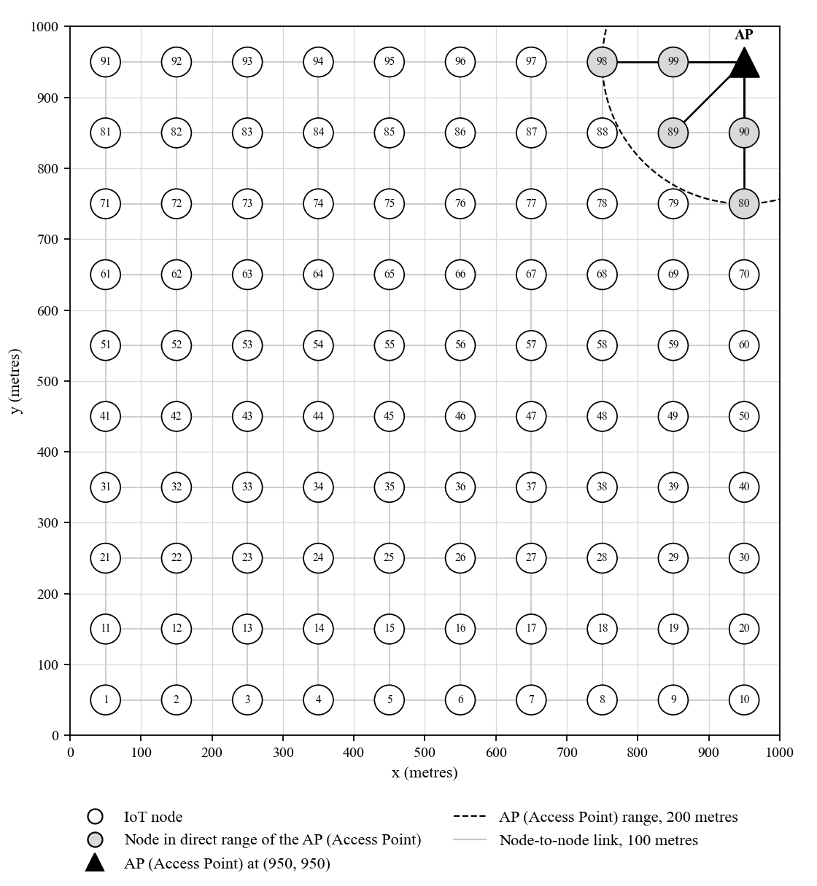
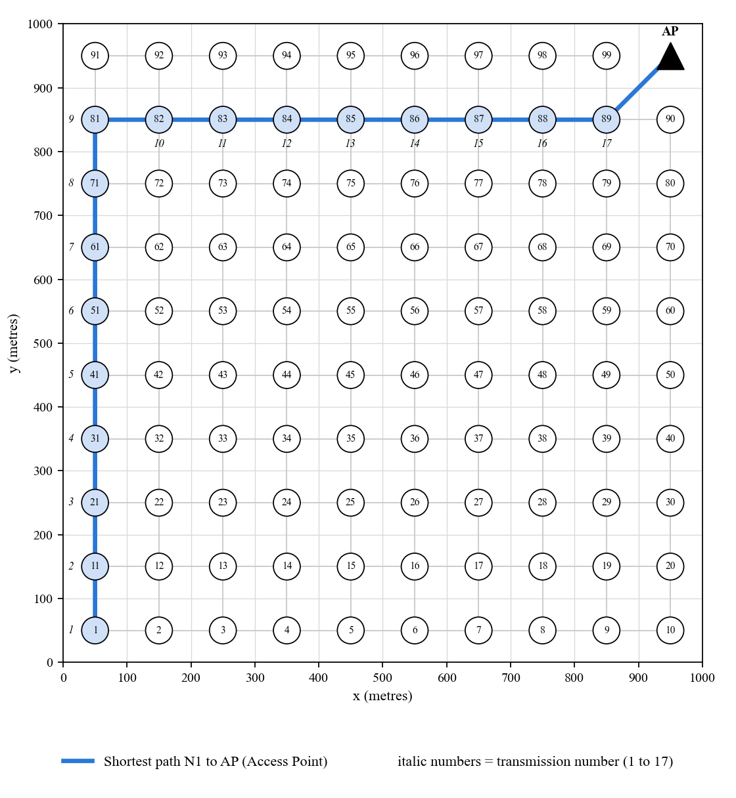
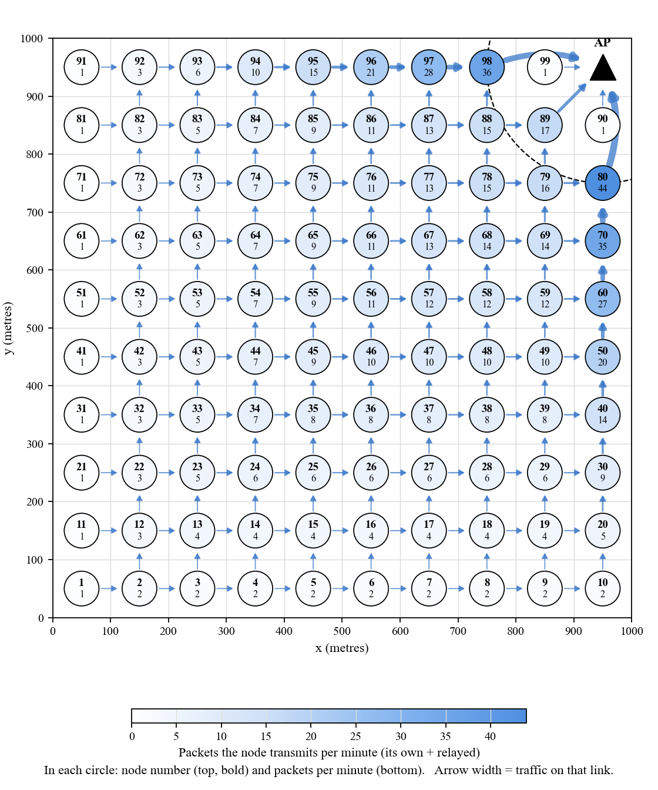
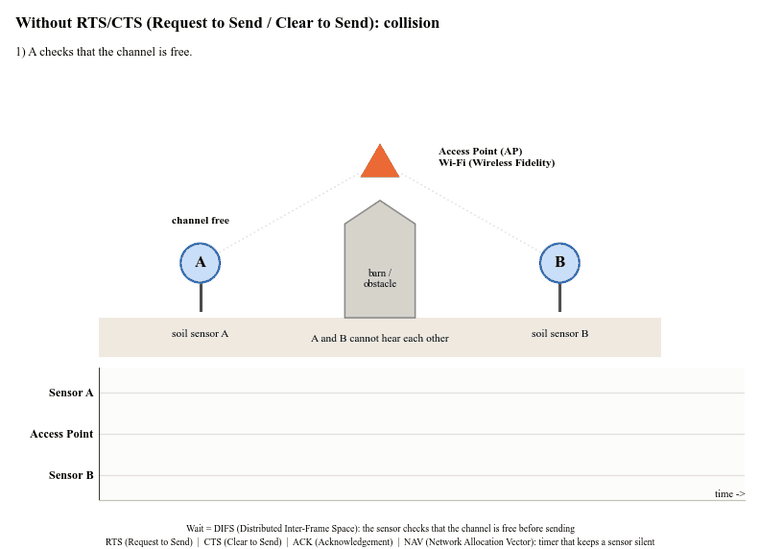
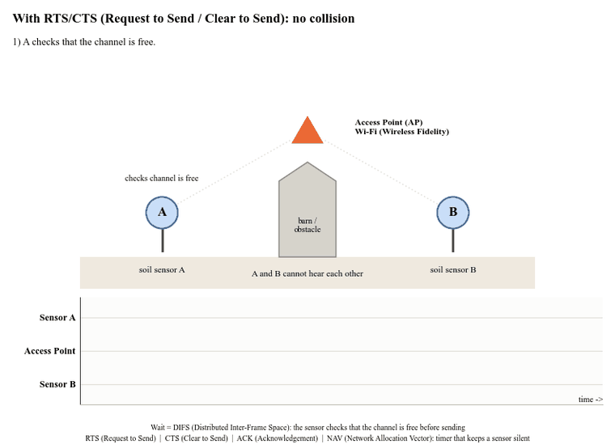
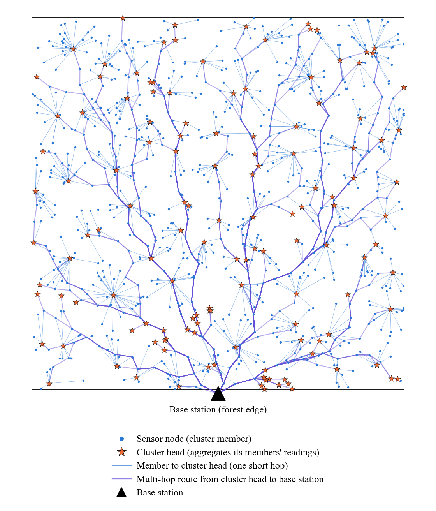

# IT863 Internet of Things — Assignment 01

**Solution with Simulations**

Military College of Signals, National University of Sciences and Technology (NUST) 
MSSE 32 &nbsp;•&nbsp; Fall 2026 
Submitted by <b>Ali Hamza</b> (536657) &nbsp;•&nbsp; Instructor: <b>Prof. Dr. Javed Iqbal</b>

📄 **[Download the full report — PDF](Ali%20Hamza_IoT_Assignment%201.pdf)** 
🖥️ **Live interactive simulation:** [https://iot-assignment-01-5dfaux8t73d8cxdkzp3d5h.streamlit.app/?q=1](https://iot-assignment-01-5dfaux8t73d8cxdkzp3d5h.streamlit.app/?q=1)

---

## Contents

- [Question 1: IoT Sensing Network over 1 km × 1 km](#question-1-iot-sensing-network-over-1-km--1-km)
- [Question 2: IEEE 802.11 RTS/CTS (Request to Send / Clear to Send) Mechanism](#question-2-ieee-80211-rtscts-request-to-send--clear-to-send-mechanism)
- [Question 3: Forest-Fire Monitoring Wireless Sensor Network](#question-3-forest-fire-monitoring-wireless-sensor-network)

Every simulation is shown below as an animated GIF preview. Click
**▶ Watch the video** under a preview to open the full-quality MP4 video.

---

## Question 1: IoT Sensing Network over 1 km × 1 km

> **Question 1.** Consider an IoT sensing network to be deployed over a 1 km × 1 km (1000 m × 1000 m) square area.
> A single Internet-connected Access Point (AP) is located at the top-right corner of the sensing area.
>
> Assumptions:
> 1. Each IoT sensor node has a maximum wireless communication range of 100 m. Two IoT nodes can directly
>    communicate if their Euclidean separation is ≤ 100 m.
> 2. The AP (Access Point) has a wireless communication range of 200 m.
> 3. Each IoT node generates one sensor-data packet every minute.
> 4. IoT nodes that cannot directly communicate with the AP (Access Point) must forward their data through other IoT nodes
>    using multi-hop communication.
> 5. Assume ideal wireless conditions: no packet loss, interference, retransmissions, or physical obstacles.
> 6. The objective is to achieve complete network connectivity to the AP (Access Point) while using as few IoT nodes as
>    reasonably possible.
> 7. You are not given a predefined grid spacing or node coordinates. You must determine and justify an appropriate
>    placement.

### (a) Placement, spacing and number of nodes

> **Question 1 (a).** Design a suitable placement of IoT nodes over the 1 km × 1 km (1000 m × 1000 m) area.
> Determine an appropriate node spacing and the total number of nodes required. Draw the proposed placement, clearly
> showing the AP (Access Point) and the IoT nodes.

- Square grid with node spacing **d = 100 m**.
- First node N1 at **(50, 50)**.
- This gives 10 × 10 = 100 grid positions. The last top-right position **(950, 950)** is the **AP (Access Point)**.
- Total IoT nodes required = **99** (N1 to N99, numbered row by row from the bottom-left).

<i>Proposed placement: 99 IoT nodes at 100 m spacing and the AP (Access Point) at (950, 950). Grey nodes are
within the 200 m range of the AP (Access Point).</i>

### (b) Justification and connectivity

> **Question 1 (b).** Justify your selected node spacing and placement. Demonstrate that every IoT node can
> ultimately reach the AP (Access Point), either directly or through multi-hop communication, while maintaining the ≤ 100 m
> communication-distance constraint between directly communicating IoT nodes.

- **Spacing:** neighbouring nodes (left, right, up, down) are exactly 100 m apart, which equals the node range, so
  every neighbour link satisfies the ≤ 100 m constraint.
- **Fewest nodes:** any spacing larger than 100 m breaks the links; any smaller spacing adds nodes that are not
  needed. 100 m is therefore the largest valid spacing and needs the fewest nodes.
- **Coverage:** the 50 m offset from the edges places each node at the centre of its own 100 m × 100 m cell, so no
  point of the area is more than 70.7 m from a node.
- **Every node reaches the AP (Access Point):** from any node, the neighbour 100 m to its right or 100 m above it is one hop
  closer to the AP (Access Point). Repeating this step always reaches one of the five nodes inside the 200 m range of the AP (Access Point),
  which then sends directly to the AP (Access Point). The farthest node, N1, needs 17 transmissions; all 99 nodes are connected.

### (c) Direct nodes and shortest path

> **Question 1 (c).** Identify the IoT nodes that can communicate directly with the AP (Access Point). Select a node that
> cannot directly reach the AP (Access Point) and determine a shortest multi-hop path from that node to the AP (Access Point). State the
> number of IoT-to-IoT hops and total wireless transmissions, including
> the final AP (Access Point) transmission.

**Nodes in direct range of the AP (Access Point) at (950, 950), distance ≤ 200 m:**

- N99 at (850, 950): 100 m
- N90 at (950, 850): 100 m
- N89 at (850, 850): 141.4 m
- N98 at (750, 950): 200 m
- N80 at (950, 750): 200 m

**Selected node:** N1 at (50, 50).

**Shortest path:** N1 → N11 → N21 → N31 → N41 → N51 → N61 → N71 → N81 → N82 → N83 → N84 → N85 → N86 → N87 → N88 →
N89 → AP (Access Point)

- IoT-to-IoT hops = **16**
- Total wireless transmissions = 16 + 1 (final hop N89 → AP (Access Point)) = **17**

<i>Shortest multi-hop path from N1 to the AP (Access Point): 16 IoT-to-IoT hops and 17 transmissions.</i>

### (d) Traffic accumulation and the energy hole

> **Question 1 (d).** Each IoT node generates one packet per minute. Explain how traffic accumulates toward the
> AP (Access Point). Identify the nodes or region expected to experience the highest forwarding load and explain the
> energy-hotspot/energy-hole problem.

Each node generates one packet per minute. Nodes closer to the AP (Access Point) forward their own packets as well as packets
received from nodes farther away.

The forwarding load increases toward the AP (Access Point) because traffic from multiple branches converges near the top-right
corner. Nodes adjacent to the AP (Access Point) therefore carry a disproportionately high forwarding burden.

This creates the energy-hole problem: heavily loaded relay nodes deplete their batteries faster than nodes farther
away. When these relays fail, distant nodes may lose their routes to the AP (Access Point), reducing network coverage and
lifetime.

<i>Forwarding load of every node (node number on top, packets transmitted per minute below). Arrows show the traffic converging on the AP (Access Point).</i>

### (e) Technique: unequal clustering

> **Question 1 (e).** Suggest one technique that could reduce the energy burden on heavily loaded nodes and explain
> how it can improve the network lifetime.

Unequal clustering can reduce the energy burden on nodes near the AP (Access Point). Smaller clusters can be formed near the AP (Access Point),
reducing the number of local packets that heavily loaded nodes must process and forward. Cluster heads can aggregate
readings before forwarding them.

This reduces redundant transmissions and balances energy consumption, potentially extending the network's
operational lifetime.

---

## Question 2: IEEE 802.11 RTS/CTS (Request to Send / Clear to Send) Mechanism

> **Question 2.** Consider a smart agriculture IoT system in which battery-powered soil-moisture
> sensors A and B periodically send their sensed data to a Wi-Fi (Wireless Fidelity)-enabled IoT
> Access Point (AP). Due to the field layout and obstacles, A and B cannot hear each other directly, although both are
> within communication range of the AP (Access Point).

### (a) Why can a collision occur?

> **Question 2 (a).** Explain why a collision may occur when A and B attempt to send their sensor readings to the
> AP (Access Point) at approximately the same time.

Sensors A and B cannot hear each other, but both can communicate with the AP (Access Point). If both transmit
simultaneously, their signals may overlap at the AP (Access Point), causing a packet collision. This is an example of
the hidden-terminal problem: A and B cannot detect each other's transmissions, even though both share the same
receiver.

<b><a href="media/videos/q2_hidden.mp4">▶ Watch the video</a></b> — hidden-terminal collision without RTS/CTS (Request to Send / Clear to Send)

### (b) Complete RTS/CTS (Request to Send / Clear to Send) communication sequence

> **Question 2 (b).** Using the RTS/CTS (Request to Send / Clear to Send) mechanism of IEEE 802.11, describe the
> complete communication sequence when sensor A wants to transmit its soil-moisture reading to the AP (Access Point).

When sensor A wants to send a soil-moisture reading, the sequence is:

1. **Channel check** 
   Sensor A senses the wireless channel and waits until it is free.
2. **RTS (Request to Send)** 
   A sends an RTS (Request to Send) frame to the AP (Access Point), requesting permission to transmit and indicating
   the expected reservation duration.
3. **CTS (Clear to Send)** 
   After receiving the RTS (Request to Send), the AP (Access Point) responds with a CTS (Clear to Send) frame,
   granting permission and announcing the remaining reserved transmission duration.
4. **DATA transmission** 
   A sends its soil-moisture data to the AP (Access Point).
5. **ACK (Acknowledgement)** 
   The AP (Access Point) sends an ACK (Acknowledgement) after successfully receiving the data frame.

The basic exchange is:

<b>RTS (Request to Send)</b> &nbsp;→&nbsp; <b>CTS (Clear to Send)</b> &nbsp;→&nbsp; <b>DATA</b> &nbsp;→&nbsp; <b>ACK (Acknowledgement)</b>

Short interframe spaces (SIFS) separate the CTS (Clear to Send), DATA, and ACK (Acknowledgement) exchanges as
specified by IEEE 802.11.

<b><a href="media/videos/q2_rtscts.mp4">▶ Watch the video</a></b> — complete RTS (Request to Send) / CTS (Clear to Send) / DATA / ACK (Acknowledgement) exchange

### (c) How does CTS (Clear to Send) prevent sensor B from transmitting?

> **Question 2 (c).** Explain how the CTS (Clear to Send) message received by sensor B helps prevent B from
> transmitting while A is communicating with the AP (Access Point).

Sensor B receives the AP's (Access Point's) CTS (Clear to Send) frame even though it cannot hear sensor A. The CTS
(Clear to Send) contains a duration field that informs B how long the medium is reserved. B updates its Network
Allocation Vector (NAV) and defers transmission during the reserved period.

Consequently, B avoids transmitting while A communicates with the AP (Access Point), reducing the likelihood of a
collision.

*The video in part (b) shows this: after the CTS (Clear to Send), sensor B's NAV (Network Allocation Vector) timer
keeps it silent until the ACK (Acknowledgement) is sent.*

### (d) One benefit and one drawback for battery-powered IoT nodes

> **Question 2 (d).** From an IoT perspective, explain one benefit and one drawback of using
> RTS/CTS (Request to Send / Clear to Send) for battery-powered sensor nodes.

**Benefit:** RTS/CTS (Request to Send / Clear to Send) reduces hidden-terminal collisions, avoiding wasted energy from
unsuccessful data transmissions and retransmissions.

**Drawback:** RTS (Request to Send) and CTS (Clear to Send) add control-frame overhead, extra channel access time, and
additional energy consumption. For small, frequent sensor packets, this overhead may outweigh the benefits.

---

## Question 3: Forest-Fire Monitoring Wireless Sensor Network

> **Question 3.** A forest-fire monitoring system consists of 1,000 battery-powered sensor nodes randomly deployed over
> a large forest. Each node measures temperature, humidity and smoke concentration. The nodes forward information to a
> base station located at the edge of the forest.

### (a) Star/single-hop versus multi-hop mesh topology

> **Question 3 (a).** Would you select a star/single-hop or multi-hop mesh topology? Justify your choice from the
> perspective of energy consumption and coverage.

A multi-hop mesh topology is more suitable for the forest-fire monitoring system.

- **Energy consumption:** Distant sensors can forward data through nearby nodes instead of transmitting directly over
  long distances, potentially reducing transmission energy.
- **Coverage:** Multi-hop communication extends connectivity across a large forest, including locations outside the
  base station's direct communication range.
- **Reliability:** Multiple possible routes can provide alternative paths when individual nodes or links fail.

A single-hop star topology would require every sensor to reach the base station directly, potentially consuming more
energy and limiting coverage.

### (b) Flat versus hierarchical/clustered WSN (Wireless Sensor Network) architecture

> **Question 3 (b).** Would a flat or hierarchical/clustered WSN (Wireless Sensor Network) architecture be more
> suitable? Explain your choice.

A hierarchical/clustered architecture is more suitable for 1,000 randomly deployed sensors.

The network is divided into clusters, each managed by a cluster head. Ordinary sensor nodes send their readings to
their cluster head, which aggregates the data and forwards it toward the base station.

Advantages include:

- Reduced redundant transmissions.
- Better scalability for a large sensor network.
- Lower communication overhead for ordinary nodes.
- More efficient coordination and energy management.

Cluster heads should be rotated or selected using residual energy and communication cost to avoid premature battery
depletion.

<i>Hierarchical/clustered multi-hop WSN (Wireless Sensor Network) for the forest: 1,000 sensor nodes over a 2 kilometre × 2 kilometre forest. Each cluster head aggregates its members' readings and forwards them to the base station over a multi-hop route.</i>

### (c) How data aggregation extends network lifetime

> **Question 3 (c).** Explain how data aggregation at intermediate nodes or cluster heads can extend network lifetime.

Data aggregation combines readings from multiple sensors into a compact summary before forwarding them. For example,
a cluster head can calculate average temperature and humidity while preserving maximum temperature and smoke readings
that may indicate a fire.

Without aggregation, many individual packets must travel toward the base station. With aggregation, fewer packets are
transmitted over long distances, reducing communication energy and congestion. This helps conserve battery power and
extends network lifetime while retaining important fire-detection information.

---

> **Declaration:** AI tools were used for the simulations and the coding; all of this work has been reviewed and edited by me.
